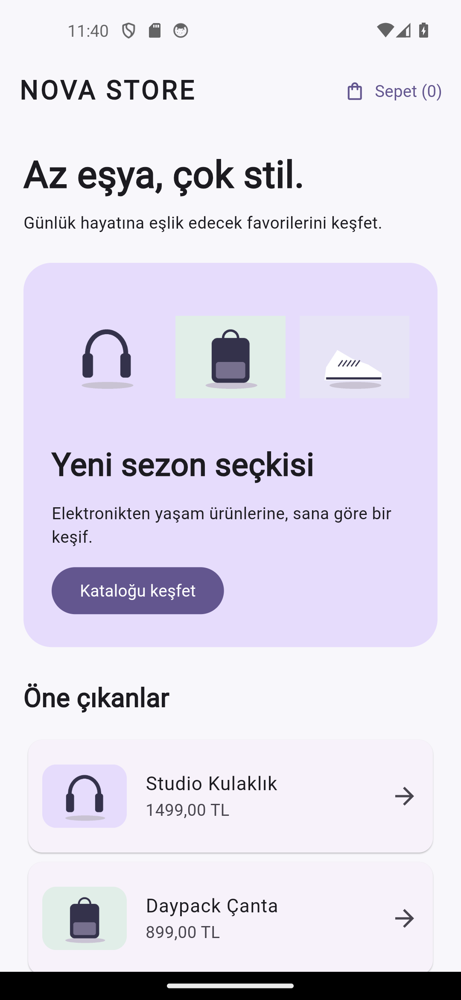
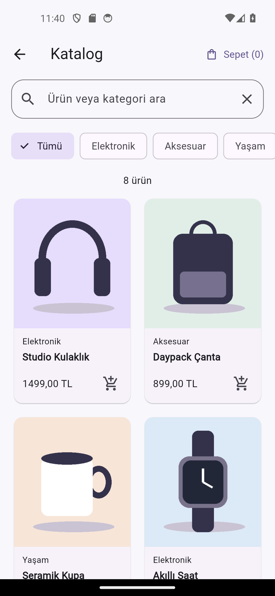
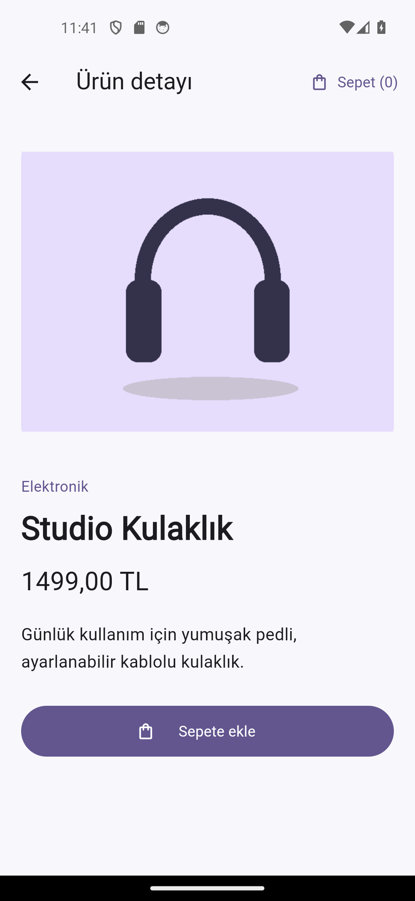
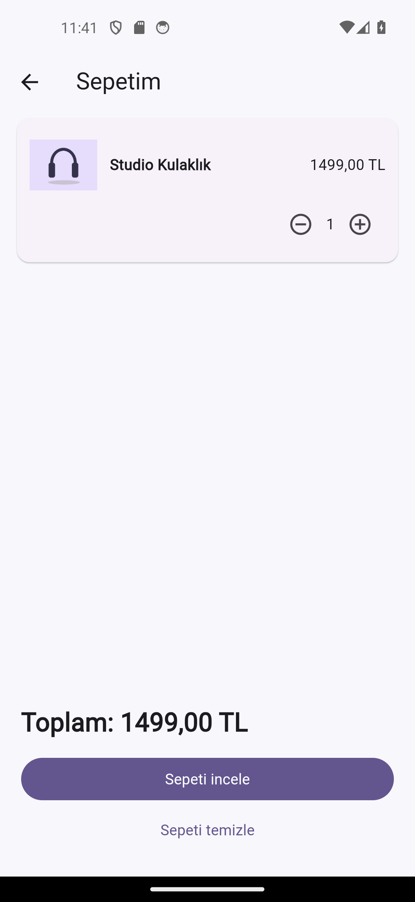

# NOVA STORE — Mini Katalog

Flutter ve Dart ile hazırlanmış eğitim amaçlı katalog uygulaması. Ana sayfa, aranabilir ve kategoriye göre filtrelenebilir ürün kataloğu, ürün detayı ve adet yönetimli sepet içerir. Sekiz ürünün JSON verileri, görselleri ve Roboto yazı tipi uygulamaya dahildir; uygulamanın kullanımı internet bağlantısı gerektirmez. Gerçek sipariş veya ödeme oluşturulmaz.

**GitHub:** [Berivanilgun/NOVA_STORE_Flutter](https://github.com/Berivanilgun/NOVA_STORE_Flutter)

## Güncel durum

15 Ekim 2026 tarihinde yerel ortamda yapılan doğrulama:

| Kontrol | Sonuç |
| --- | --- |
| Uygulama sürümü | `1.0.0+1` |
| Flutter / Dart | Flutter `3.38.5` (stable), Dart `3.10.4` |
| `flutter pub get` | Başarılı |
| `flutter analyze` | Başarılı; analiz sorunu bulunmadı |
| `flutter test` | 6 testin tamamı başarılı |
| Ekran görüntüleri | Dört widget renderı ve normal/%130 metin boyutunda sekiz Android emülatör görüntüsü |
| Android kontrolü | Pixel 5 emülatörü, Android 14; ana sayfa, arama/filtre, detay, sepet ve büyük metin akışları doğrulandı |
| Release APK | Başarıyla derlendi ve emülatöre kuruldu |
| iOS / fiziksel cihaz | Bu ortamda doğrulanmadı |

Akış testlerindeki zaman aşımı giderildi: uygulama açılışı gerçek asenkron zamanda çalıştırılıyor, ürün görselleri render öncesinde yükleniyor ve ekran görüntüsü testlerinde Material ikon fontu hazırlanıyor. Büyük metin, ortak sepet, demo açıklaması ve dolu sepetin yeniden başlatmada sıfırlanması için ek akış testi bulunur. Ayrıntılar: [doğrulama raporu](docs/DOGRULAMA.md).

## Özellikler

- Ürün görselleri bulunan ana sayfa bannerı ve katalog bağlantısı.
- Elektronik, Aksesuar, Yaşam ve Giyim kategorilerinde toplam sekiz ürün.
- Ürün adı/kategori araması ile birlikte çalışan kategori filtresi; boş sonuç ve arama temizleme desteği.
- Ekran genişliğine göre 2, 3 veya 4 sütunlu ürün listesi.
- Görsel, açıklama ve fiyat içeren ürün detay sayfası.
- Katalogdan ve detaydan aynı sepete ürün ekleme; adet artırma/azaltma, toplam hesaplama ve onaylı sepet temizleme.
- Yerel JSON yüklenirken bekleme göstergesi; hata durumunda tekrar deneme.
- Material 3 teması ve yerel Roboto yazı tipi.

Sepet `ChangeNotifier` ile bellekte tutulur ve uygulama yeniden başlatıldığında sıfırlanır. Fiyatlar tam sayı kuruş olarak saklanır ve TL biçiminde gösterilir. Flutter SDK dışında ek çalışma zamanı paketi kullanılmaz.

## Kurulum ve çalıştırma

Flutter SDK gereklidir. Projenin Dart SDK koşulu `>=3.4.0 <4.0.0` olarak tanımlıdır; yukarıdaki sürümler bu ortamda doğrulanan sürümlerdir. Android için Android SDK ve bir emülatör veya fiziksel cihaz; iOS için macOS ve Xcode gerekir. Android, iOS ve web platform klasörleri depoda mevcuttur.

```powershell
git clone https://github.com/Berivanilgun/NOVA_STORE_Flutter.git
cd NOVA_STORE_Flutter
flutter doctor
flutter pub get
flutter devices
flutter run
```

Birden fazla cihaz varsa `flutter run -d <cihaz-id>` kullanın. Web için:

```powershell
flutter run -d chrome
```

Flutter bulunamıyorsa SDK'nın `bin` klasörünü PATH'e ekleyip terminali yeniden açın. İlk kurulumda SDK ve bağımlılık indirmeleri için internet bağlantısı gerekebilir.

## Analiz ve testler

```powershell
flutter analyze
flutter test
```

Sürüm kontrolü, bağımlılık kurulumu, analiz ve testleri sırayla çalıştırmak için:

```powershell
.\scripts\verify.ps1
```

Mevcut test kapsamı:

- `test/cart_test.dart`: Sepet adedi, toplam, son ürünü kaldırma ve model JSON dönüşümü.
- `test/widget_test.dart`: Ana sayfanın açılması.
- `test/store_flow_test.dart`: Yerel varlıklar, arama/kategori filtresi, boş sonuç, detay, sepet adedi/temizleme, %130 metin, ortak sepet, demo açıklaması ve yeniden başlatma akışları.

## Proje yapısı

```text
lib/
  main.dart             # Uygulama, tema, JSON yükleme ve detay rotası
  models/product.dart   # Ürün modeli ve TL fiyat biçimlendirme
  data/cart.dart        # Ortak sepet durumu, adet ve toplam
  screens/store.dart    # Ana sayfa, katalog, detay, sepet ve ürün kartları
assets/
  products.json         # Sekiz demo ürün
  images/               # Yerel ürün görselleri
  fonts/                # Roboto ve lisansı
scripts/verify.ps1      # Analiz, test ve isteğe bağlı ekran görüntüsü üretimi
test/                   # Birim ve widget testleri
docs/                   # Yönerge karşılaştırması ve teslim belgeleri
```

Sayfa geçişleri `Navigator.push/pop`, ürün detayına veri aktarımı `Navigator.pushNamed` ile yapılır.

## Veri kaynakları

Ürünler `assets/products.json` dosyasından, görseller `Image.asset` ile yüklenir. Yönergede örneklenen wantapi.com kaynakları yerine yerel demo verileri kullanılmıştır; çevrimiçi API bağlantısı bulunmaz. JSON'da her ürün için `id`, `name`, `category`, `priceKurus`, `description` ve `image` alanları yer alır.

## Ekran görüntüleri

Widget renderlarını yeniden üretmek için:

```powershell
.\scripts\verify.ps1 -CaptureScreenshots
```

Betik analiz ve testler başarılı olursa Flutter widget ağacını 390 × 844 boyutunda render ederek `docs/screenshots/` altında `home.png`, `catalog.png`, `detail.png` ve `cart.png` üretir. Bunlar widget renderlarıdır; Android cihaz ekran görüntüsü değildir. Üretilen dört render görsel olarak kontrol edildi. Android emülatöründen alınan gerçek ekran görüntüleri ayrıca `docs/screenshots/android/` klasöründedir.

| Ana sayfa | Katalog | Ürün detayı | Sepet |
| --- | --- | --- | --- |
|  |  |  |  |

Ayrıntılar ve büyük metin görüntüleri: [ekran görüntüsü üretim adımları](docs/screenshots/README.md).

## Android APK

```powershell
flutter build apk --release
```

Çıktı: `build/app/outputs/flutter-apk/app-release.apk`. Release APK başarıyla derlendi ve Pixel 5 emülatöründe çalıştırıldı. Mevcut Gradle ayarı release derlemesini debug anahtarıyla imzalar; bu APK demo kullanımına yöneliktir.

## Teslim belgeleri

[Yönerge karşılaştırması](docs/YONERGE_UYUM.md) ve [kabul kontrol listesi](docs/KONTROL_LISTESI.md) depoda bulunur. Analiz, testler, Android emülatör kontrolü ve ekran görüntüleri tamamlandı. Depo public olarak erişilebilir. Doğrulama kapsamı Android emülatörü ve widget testleridir; fiziksel cihaz ve iOS kontrolleri yapılmadı.
